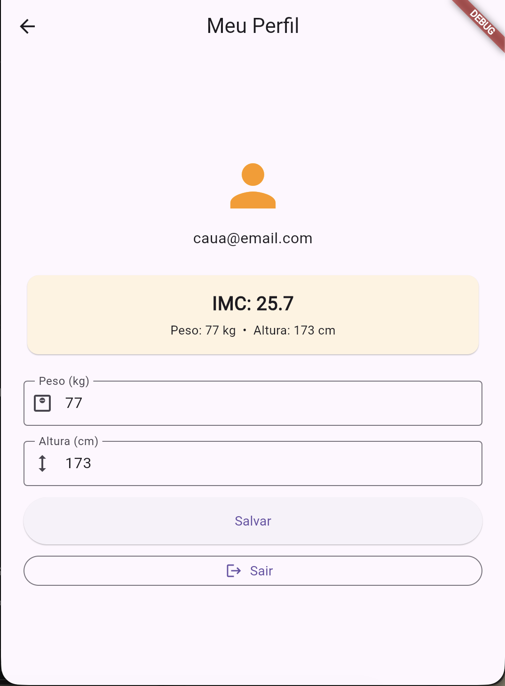
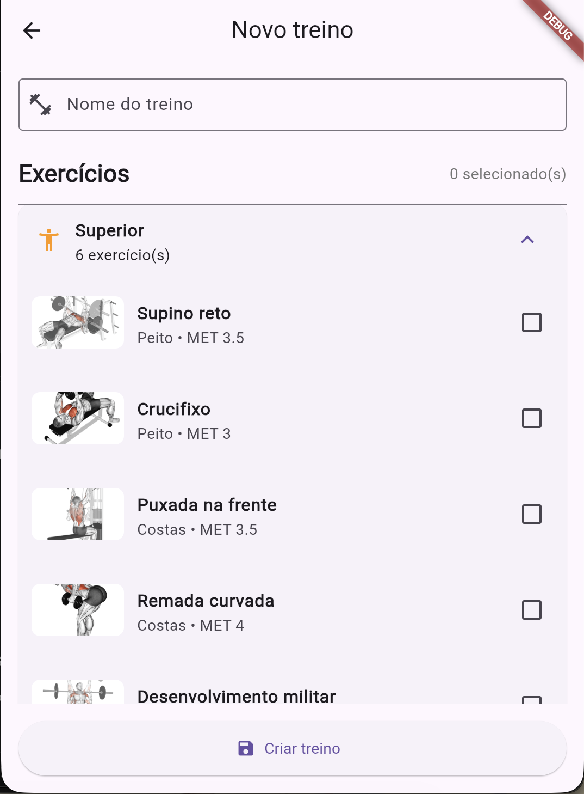
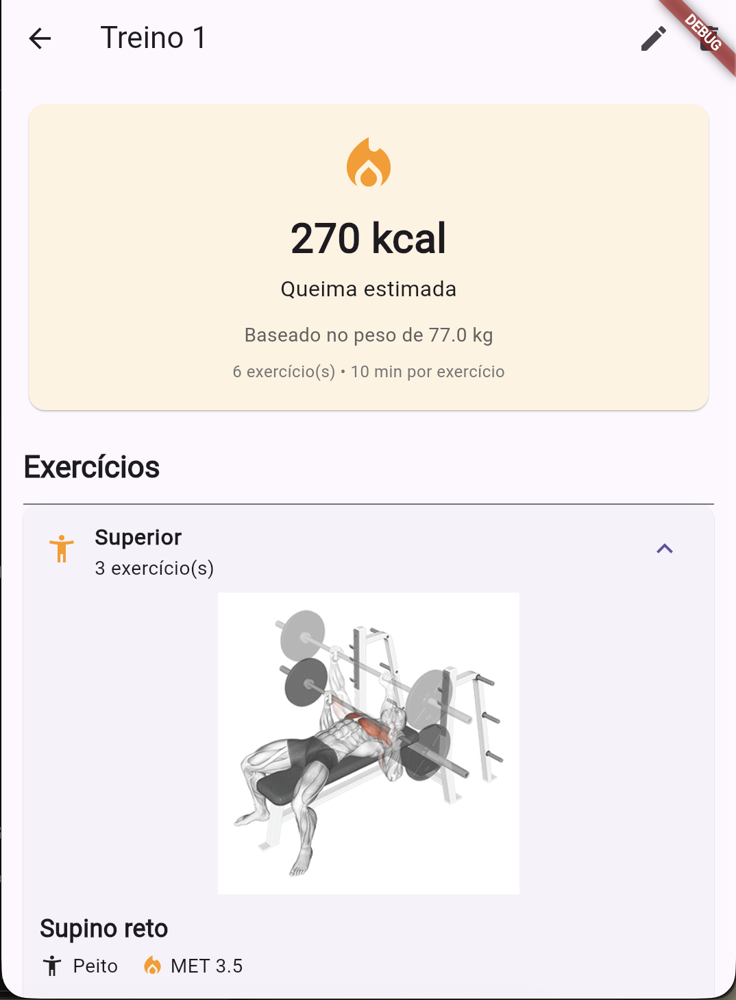

## 🏋️ Pump
Aplicativo para montagem de guias de treino na academia. O usuário seleciona exercícios separados por macro-região corporal (Superior, Inferior, Core) e visualiza uma estimativa de queima calórica baseada no seu peso.

### 📱 Telas do Aplicativo
Aqui estão as principais telas do projeto:

Tela de Login<br>


Tela de Cadastro<br>


Tela Inicial (Home)<br>


Tela de Perfil<br>


Tela de criação de treino<br>


Tela de visualização de treino<br>


### ⚙️ Funcionalidades Principais
Autenticação: Cadastro, login e logout com e-mail e senha (Firebase Auth).

Proteção de Rotas: Telas internas só são acessíveis por usuários autenticados.

CRUD de Treinos: Criar, listar, editar e deletar treinos vinculados ao usuário logado.

Catálogo de Exercícios: Exercícios organizados por macro-região e músculo.

Cálculo de Calorias: Estimativa de queima calórica usando a fórmula METs (baseada no peso do usuário).

Perfil: Atualização de peso e altura, com cálculo de IMC.

### 🛠️ Tecnologias Utilizadas
Flutter / Dart (Interface e lógica)

Firebase Authentication (Autenticação)

Cloud Firestore (Banco de dados NoSQL)

GoRouter (Gerenciamento de rotas e proteção de telas)

### 🚀 Como Executar o Projeto

Clone o repositório:
```bash
git clone https://github.com/ccqsantos/pump.git
cd pump
```

Instale as dependências:
```bash
flutter pub get
```

#### Configure o Firebase:
O Firebase já está configurado pois o repositório contém as dependências necessárias.


### Execute o aplicativo:
```bash
flutter run -d web-server
```

### 🔐 Autenticação e Base de Dados
Autenticação: Utiliza o Firebase Auth. Erros como e-mail já cadastrado ou senha incorreta são tratados e exibidos de forma amigável na interface.

#### Banco de Dados: 
O Cloud Firestore armazena os dados no formato usuarios/{uid} (dados do perfil) e usuarios/{uid}/treinos/{treinoId} (treinos). As regras de segurança garantem que o usuário só acesse seus próprios dados.

## Observação

O projeto foi desenvolvido utilizando Flutter e Firebase para rodar na web. As plataformas mobile poderão ser implementadas no futuro.

